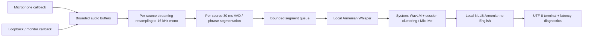

# Architecture

Implemented baseline; hardware and model acceptance tests are still outstanding.

`audio/capture.py` owns native-rate streams and resource cleanup. Windows uses PyAudioWPatch
WASAPI loopback; Linux/macOS use sounddevice inputs with manual monitor/virtual-device routing.
Callback failures and buffer overruns are propagated to the main loop.

`pipeline.Framer` downmixes upstream and resamples with soxr state preserved across callbacks.
It emits exact 480-sample frames to WebRTC VAD. A missing-loopback-buffer gap resets the
resampler/sample timeline; timer endpointing also works while the other source remains busy.

`core.Segmenter` retains speech through brief pauses, endpoints after 450 ms silence, removes
trailing silence, suppresses very short bursts and caps continuous chunks at three seconds.
Segments carry monotonic start and last-speech-end timestamps. Those clocks are shared across
sources; callback arrival approximates device time and cannot account for unknown OS latency.

A single inference worker owns all models and session centroids, avoiding concurrent model
mutation/GPU contention. The four-item queue bounds memory, not latency. Full queues fail
visibly. The microphone bypasses speaker inference. The system side matches normalized WavLM
embeddings against session centroids; unseen voices create monotonically numbered labels.
This assumes one dominant speaker per chunk and cannot resolve overlap or within-chunk turns.

`models.py` contains the inference adapters and a separate explicit download operation.
Runtime enables offline mode and loads only local directories. Warmup completes before capture.
`pipeline.Processor` prints time/speaker/HY/EN, then measures through stdout flush and reports
whether the last-speech-end-to-output interval exceeded five seconds.

Ctrl+C stops devices and drains queued segments plus active endpointed audio. A final partial
resampler frame and pending raw callback buffers are not drained. Failure paths close devices;
a failed inference thread cannot block shutdown. Audio/text remain in memory only.

Tests cover pure state transitions, clustering identity persistence, mic bypass, terminal
formatting, latency accounting and streaming resampling. They do not assert live Armenian
quality, real speaker separation, audio routing or a five-second hardware result.
